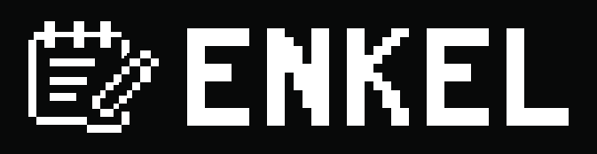

  

<h3 align="center">Enkel — Minimalist Markdown Notes</h3>

  <strong>Open. Write. Save. Nothing else gets in the way.</strong> 
  <em>Your knowledge. Your files. Your space.</em>

---

## Sobre o Enkel

**Enkel** (palavra norueguesa para *"simples"*) é um bloco de notas desktop minimalista e **local-first** para arquivos Markdown (`.md`), projetado com estética inspirada no Omarchy e no Neovim: fundo escuro (`#161616`), destaque de sintaxe em tempo real, numeração de linhas, indentação por `Tab` e zero distrações.

Ele abre instantaneamente, posiciona o cursor pronto para escrever e salva tudo diretamente no seu computador em arquivos `.md` reais — sem contas, sem nuvem, sem telemetria e sem processos pesados em segundo plano.

---

## Funcionalidades

- **Editor Markdown com Realce de Sintaxe (CodeMirror 6):**
  - Títulos (`#`), negrito (`**texto**`), itálico (`*texto*`), código inline (`` `código` ``), blocos de código, citações, links e listas com destaque colorido em tempo real no próprio texto.
  - Numeração de linhas na lateral esquerda e quebra de linha confortável.
  - Indentação com `Tab` e `Shift + Tab`, além de continuação inteligente de listas e checklists ao pressionar `Enter`.
- **Preview Opcional (`Ctrl + E`):** Alterne rapidamente entre o editor Markdown e a visualização renderizada com um clique ou atalho.
- **Sem Corretor Ortográfico Intrusivo (`spellcheck="false"`):** Escreva termos técnicos, código, comandos e anotações livremente sem sublinhados vermelhos.
- **Imagens em Markdown (`Ctrl + V` ou Upload):** Cole imagens da área de transferência ou envie arquivos do computador; elas são copiadas automaticamente para `assets/imagens/` no seu espaço de trabalho com referências relativas (``).
- **Salvamento Automático Confiável (Atomic Autosave):** Salva automaticamente enquanto você digita (com escrita atômica em disco via arquivo temporário + `fsync`), protegendo seus arquivos contra perda de dados.
- **Barra Lateral Direita Recolhível:**
  - Navegação simples por pastas, subpastas e arquivos `.md`.
  - Criação, renomeação e exclusão (com confirmação de segurança) de pastas e notas.
  - Pode ser recolhida (`Ctrl + \`) para dedicar 100% da janela à escrita.
- **Dados Independentes da Instalação:**
  - Seus arquivos nunca ficam armazenados dentro da pasta de instalação do aplicativo. Atualizar, substituir ou desinstalar o Enkel jamais apaga suas anotações.

---

## Atalhos de Teclado

| Atalho | Ação |
| :--- | :--- |
| `Ctrl + N` | Criar nova nota Markdown (`.md`) |
| `Ctrl + E` | Alternar entre Editor e Preview renderizado |
| `Ctrl + B` / `Ctrl + I` | Aplicar negrito / itálico |
| `Tab` / `Shift + Tab` | Aumentar / diminuir indentação |
| `Ctrl + V` | Colar imagem da área de transferência para `assets/imagens/` |
| `Ctrl + S` | Forçar salvamento imediato |
| `Ctrl + F` | Localizar texto no documento atual |
| `Ctrl + Shift + F` | Pesquisar em todos os arquivos do espaço de trabalho |
| `Ctrl + O` | Abrir rapidamente qualquer arquivo |
| `Ctrl + \` | Recolher ou expandir a barra lateral direita |

---

## Tecnologias Utilizadas

- **Backend:** [Rust](https://www.rust-lang.org/) (gerenciamento seguro do sistema de arquivos, escrita atômica, imagens e busca rápida)
- **Desktop Runtime:** [Tauri v2](https://v2.tauri.app/) (empacotamento nativo ultraleve e seguro)
- **Frontend:** [TypeScript](https://www.typescriptlang.org/) + [CodeMirror 6](https://codemirror.net/) + [Vite](https://vitejs.dev/)

---

## Licença

Distribuído sob a licença **MIT**. Consulte o arquivo [`LICENSE`](LICENSE) para mais informações.
